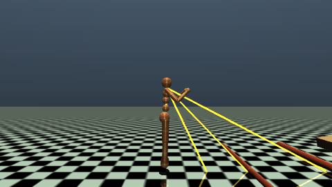
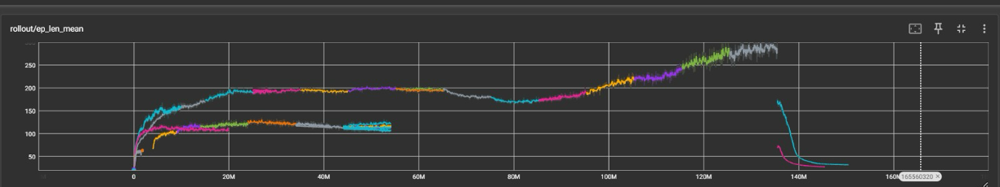
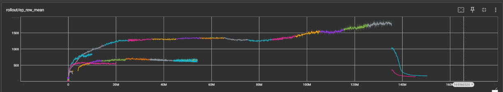

# Humanoid Locomotion over Uneven Terrain

A 3D MuJoCo humanoid trained with PPO to cross an obstacle course: two bumps, an 8° ramp and a landing pad. It "sees" the ground ahead through five rangefinder rays on its torso, so it has to react to the terrain instead of memorizing one track.

<p align="center">
  
</p>

*v33, recorded with `record.py`. No forces are applied to the robot; every movement comes from the policy.*

## Results

Measured with `python play.py --eval 50`, deterministic actions, no assistance:

| Policy | Course | Gets past both bumps | Reaches the landing pad | Furthest point (median) |
|---|---|---|---|---|
| **v30**: end of the main training chain (~160M steps) | training course | 100% | 0% | 6.6 m, about ⅔ up the ramp |
| **v33**: v30 + 5M-step ramp fine-tune | demo course | 98–100% | 62–72% | 11.2 m |

The v33 range covers three runs of 50 episodes (two seeds, plus sampled instead of deterministic actions). Results were the same on MuJoCo 4.0.1 and 3.3.7.

What v33 actually does: it climbs the ramp in a low lunge, throws itself off the top onto the landing pad, and doesn't stay upright after that. Its torso drops to about 0.5 m on the way, which is the knee-slide ("penguin slide") behavior described in the report. Crossing the course is real; walking calmly onto the pad is not something either policy learned.

> **About the original demo video.** The presentation playback script (kept in `history/course_setup/presentation_playback.py`) set the robot's forward speed to at least 1.8 m/s between x = 5 and 9.5, and it played v30. Under that script's settings (demo course, episodes ending only if the torso drops below 0.1 m), v30 reaches the landing pad in 97% of runs with the push and 3% without it. This repo leaves the push out. To reproduce the comparison:
>
> ```bash
> python play.py --policy v30 --course demo --healthy-z-min 0.1 --eval 30 --presentation-assist
> python play.py --policy v30 --course demo --healthy-z-min 0.1 --eval 30
> ```

## Quick start

```bash
python -m venv .venv && source .venv/bin/activate
pip install -r requirements.txt
python build_course.py          # writes assets/course.xml and assets/course_demo.xml
python play.py                  # watch v33 (opens a MuJoCo window)
python play.py --eval 50        # or measure it
python play.py --policy v30 --eval 50
```

Nothing here modifies the installed Gymnasium package. `course_env.py` loads Humanoid-v4 from the repo's own XML, so the observation (376 values + 5 LiDAR readings) is the same one the policies were trained on.

## How it works

- **Body and course.** MuJoCo's standard Humanoid-v4 body. `build_course.py` adds the bumps (x = 1.5 and 3.0), the ramp (x = 4 to 8) and the landing pad (x = 8 to 12). The training course has the pad top at 1.0 m. The demo course lowers it to 0.6 m, which is what v33 was fine-tuned on.
- **LiDAR.** Five rangefinders on the torso, fanned out vertically from straight down to straight ahead. A miss reads as 10 m.
- **Memory.** The last 4 observations are stacked, and observations are normalized with saved running statistics (`models/*.pkl`).
- **Training.** PPO (Stable-Baselines3), learning rate 5e-5, batches of 10,240, 10 parallel environments, torso mass and floor friction randomized every episode. Training ran in 10–15M-step chunks, each resuming from the last with an adjusted reward, so the reward could be checked and changed without starting over. `train.py` is the last chunk of that chain (v30); `history/` has earlier stages.
- **v30 reward.** Bonuses for passing each half-meter of the course and for speed; a "jump zone" near the bumps with no posture penalties; penalties for drifting sideways, twisting, leaning back, jerky actions and wasted energy; a large penalty for falling or leaving the track.
- **v33 reward** (`finetune_v33.py`). Starting from v30, extra reward for upward speed and forward momentum on the ramp (growing as it climbs) and for reaching the landing pad.

## Known issues

- **The v30 reward's foot lookups point at the wrong body parts.** `train.py` reads the feet as geoms 5 and 8, which in this model are the torso and lower waist. So the "lead foot is high" bonus near the bumps always fires, the "foot reach" bonus never does, and the lean-back check compares torso to waist rather than to the feet. It's kept as-is so `train.py` reproduces v30; using geom names (`right_foot`, `left_foot`) would fix it.
- **No recovery.** Neither policy can get back up after falling, so every episode ends at the first fall.
- **Earlier "lighter legs" change never applied.** `history/course_setup/upgrade_hardware.py` was meant to thin the shins and lighten the feet, but its text replacements don't match Gymnasium's humanoid XML, so the body was never changed. The policies were trained on the standard body.

## Repository layout

```
build_course.py     builds the two course XMLs from Gymnasium's stock humanoid
course_env.py       Humanoid-v4 loaded from a local XML, plus the LiDAR wrapper
train.py            v30 training stage (resumes from a saved model)
finetune_v33.py     v30 -> v33 ramp fine-tune
play.py             watch or evaluate a policy
record.py           save a run as GIF/MP4
models/             v30 and v33 weights + normalization stats
history/            earlier training stages and the original course/playback scripts
docs/report.pdf     course report
```

## Environment

Trained on Windows 11, Python 3.13, Stable-Baselines3 2.8.0, PyTorch 2.11 (CPU), Gymnasium 1.2.3. The repo was checked on macOS with Python 3.13 and MuJoCo 4.0.1 and 3.3.7.

## Training curves

Episode length and reward across the training chain (each color is one chunk):



